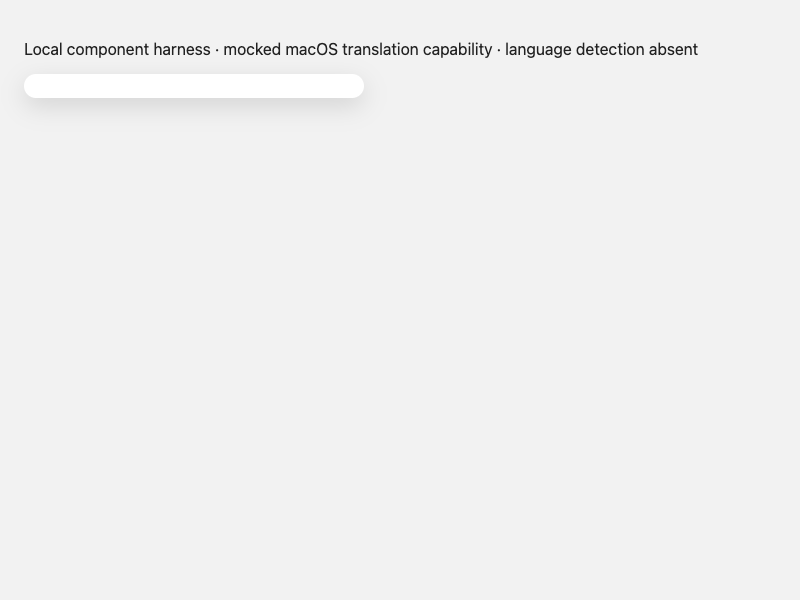
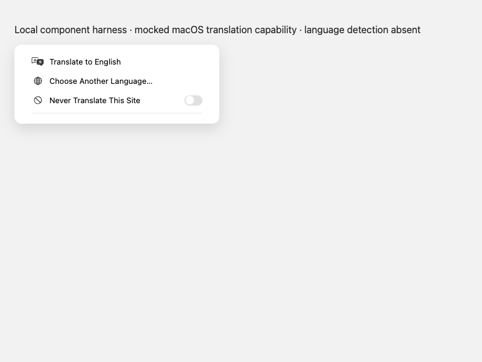
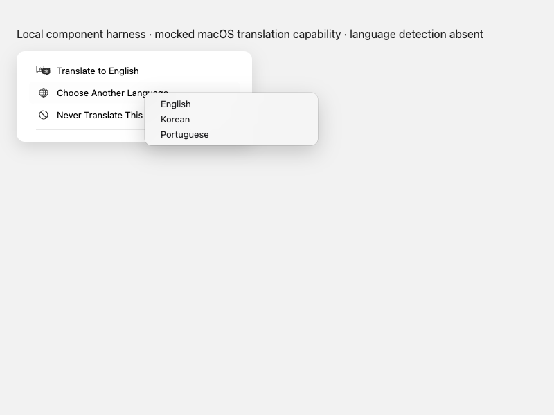
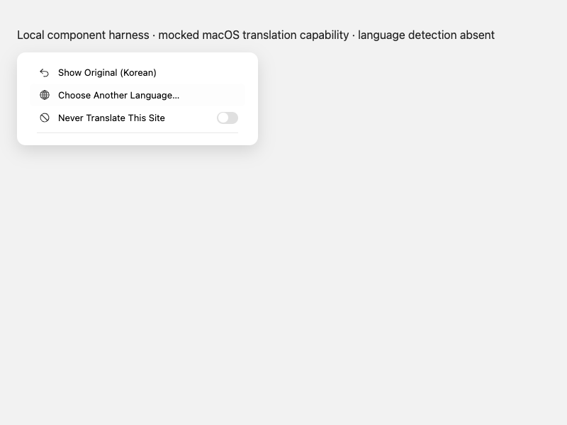

# Manual translation controls

These captures show the actual shared TranslateRows component in a local web component harness. macOS translation capability, preferred languages and supported language names are mocked; source detection is absent. They verify control visibility and language selection, not Apple model output or a rebuilt native context menu.

| Before: detection absent | After: manual controls |
| --- | --- |
|  |  |

| Choose another target | Restore the original |
| --- | --- |
|  |  |

The fixture uses English and Korean as preferred languages and offers English, Korean and Portuguese as supported languages. The before component is from ed4616613. In the after component, Translate to English and Choose Another Language remain available with source=null. A translated Korean state offers Show Original. No native context-menu screenshot is substituted with a mockup.

The native Chromium menu now accepts host items for noneditable empty-selection contexts. The app supplies a per-tab Translate to target / Show Original title and routes its command into the existing Apple translation flow. Search still requires selected text. Internal pages and platforms without an available translator receive no translation item.

The shared preview failed to capture twice with The browser is not producing screenshot frames. Captures therefore used headless Chromium. Native acceptance is blocked: the Mac has no Xcode, and the changed engine must be rebuilt. Native API is bumped to 75 to prevent older app builds from loading the new JS surface. Because the engine key covers all of engine/, a matching Linux engine is also needed before release.

Focused checks cover manual availability, original-page labels, unsupported pages/platforms, translation cancellation, passage handling, menu structure, native API versions, page event contracts and conventions. Full browser tests: 3533 passed, 1 skipped; Linux host tests: 853 passed; Linux module graph: 6 passed; browser and Linux typechecks passed. Final focused translation/API/event pass: 26 tests. Native app/engine compilation and real page-menu command delivery remain unverified.

Existing translate_used and translate_finished events measure use and completion; no new event or payload field is needed. No URLs, language samples or page text are added to telemetry.
